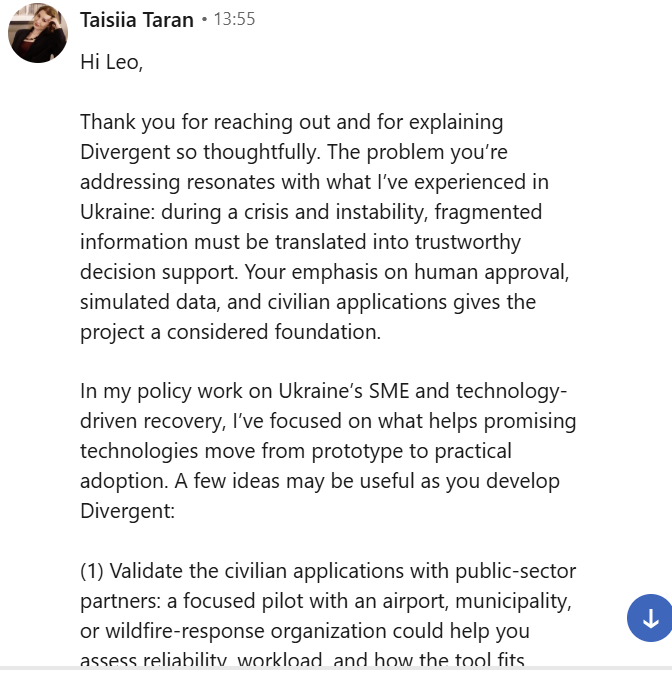
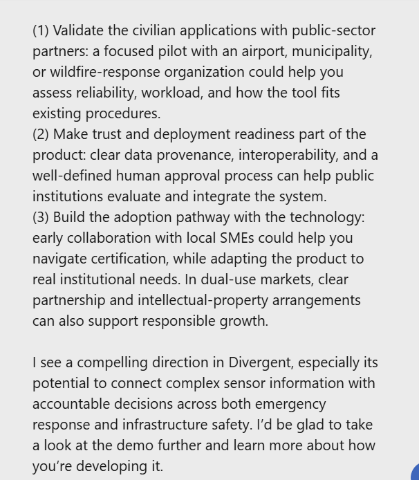

# Feedback: Taisiia Taran (LinkedIn, 2026-10-17)

**From:** Taisiia Taran, policy work on Ukraine's SME and technology-driven recovery
**To:** Leo
**Received:** 2026-10-17, 13:55, via LinkedIn message
**In reply to:** our outreach describing Divergent (sensor fusion for messy drone data, human-approved, simulated data, civilian applications)

## Message

Hi Leo,

Thank you for reaching out and for explaining Divergent so thoughtfully. The problem you're addressing resonates with what I've experienced in Ukraine: during a crisis and instability, fragmented information must be translated into trustworthy decision support. Your emphasis on human approval, simulated data, and civilian applications gives the project a considered foundation.

In my policy work on Ukraine's SME and technology-driven recovery, I've focused on what helps promising technologies move from prototype to practical adoption. A few ideas may be useful as you develop Divergent:

(1) Validate the civilian applications with public-sector partners: a focused pilot with an airport, municipality, or wildfire-response organization could help you assess reliability, workload, and how the tool fits existing procedures.
(2) Make trust and deployment readiness part of the product: clear data provenance, interoperability, and a well-defined human approval process can help public institutions evaluate and integrate the system.
(3) Build the adoption pathway with the technology: early collaboration with local SMEs could help you navigate certification, while adapting the product to real institutional needs. In dual-use markets, clear partnership and intellectual-property arrangements can also support responsible growth.

I see a compelling direction in Divergent, especially its potential to connect complex sensor information with accountable decisions across both emergency response and infrastructure safety. I'd be glad to take a look at the demo further and learn more about how you're developing it.

Best,
Taisiia Taran

## Screenshots

## Takeaways

- She says the core problem (turning fragmented crisis information into trustworthy decision support) matches her experience in Ukraine.
- She singled out human approval, simulated data and civilian applications as the strong foundation.
- Suggestions: pilot with an airport, municipality or wildfire-response org; make data provenance, interoperability and the approval process visible in the product; plan the adoption path early (local SMEs, certification, partnership/IP terms).
- She offered to look at the demo. Next step: send her the demo link.
